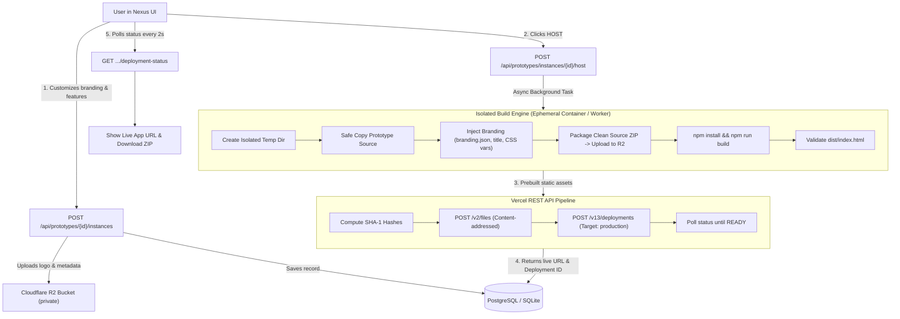

# Prototype Hosting & Deployment Automation in Nexus

This document explains the production-ready prototype customization, build engine, Cloudflare R2 asset storage, and Vercel automated deployment workflow implemented in **Nexus** (`Prototype_POC`).

---

## 1. Architecture Overview



---

## 2. Environment Configuration (`.env`)

Add the following environment variables to your backend `.env` file (or container runtime):

```env
# Application Settings
SECRET_KEY=protohub_enterprise_super_secret_jwt_key_2026_xyz
DATABASE_URL=sqlite:///prototypehub.db
FRONTEND_URL=http://localhost:5173
BACKEND_URL=http://localhost:8000

# Cloudflare R2 Object Storage
R2_ACCOUNT_ID=your_cloudflare_account_id
R2_ACCESS_KEY_ID=your_r2_access_key_id
R2_SECRET_ACCESS_KEY=your_r2_secret_access_key
R2_BUCKET_NAME=nexus-prototypes
R2_ENDPOINT_URL=https://<your_account_id>.r2.cloudflarestorage.com
R2_PUBLIC_URL=

# Vercel Deployment Integration
VERCEL_TOKEN=your_vercel_api_token
VERCEL_PROJECT_ID=nexus-prototypes
VERCEL_TEAM_ID=
```

### Local Development / Fallback Mode
When `R2_ACCESS_KEY_ID` or `VERCEL_TOKEN` are omitted:
- **R2 Storage Fallback**: Uploads are saved to `generated/r2-storage/` and served via `/api/hosting/storage/{file_path}`.
- **Vercel Fallback**: Simulates deployment with immediate validation and provides local preview URLs (`/hosted/{instance_id}`) with full logs.

---

## 3. Database Schema

The `hosted_instances` table stores complete instance tracking:

| Column | Type | Description |
|---|---|---|
| `id` | `INTEGER` | Primary key |
| `instance_id` | `VARCHAR(100)` | Unique identifier (e.g. `inst-4cf1295e5`) |
| `user_id` | `INTEGER` | Foreign key to `users.id` |
| `prototype_id` | `VARCHAR(100)` | Template prototype ID (e.g. `crm`) |
| `app_name` | `VARCHAR(150)` | Customized application name |
| `primary_color` | `VARCHAR(50)` | Primary hex color (e.g. `#E91D2B`) |
| `secondary_color`| `VARCHAR(50)` | Secondary hex color |
| `logo_storage_key`| `VARCHAR(500)`| Object key in Cloudflare R2 |
| `customization_json`| `TEXT` | Stored feature customization flags |
| `deployment_status`| `VARCHAR(50)` | `DRAFT`, `PENDING`, `BUILDING`, `UPLOADING`, `DEPLOYING`, `READY`, `FAILED` |
| `vercel_deployment_id`| `VARCHAR(200)`| Deployment ID from Vercel API |
| `live_url` | `VARCHAR(500)`| Unique production URL |
| `build_error` | `TEXT` | Detailed stderr logs if build fails |
| `deployed_at` | `DATETIME` | Timestamp of successful deployment |
| `created_at` | `DATETIME` | Timestamp created |
| `updated_at` | `DATETIME` | Timestamp last updated |

---

## 4. REST API Endpoints

### 1. Create Prototype Instance
```http
POST /api/prototypes/{prototype_id}/instances
```
**Request Body**:
```json
{
  "appName": "Acme CRM",
  "primaryColor": "#E91D2B",
  "secondaryColor": "#171A24",
  "logo": "data:image/png;base64,..."
}
```
**Response (201 Created)**: Returns instance object with status `"DRAFT"`.

### 2. List User Instances
```http
GET /api/prototypes/instances
```
Returns all customized instances belonging to the authenticated user.

### 3. Get Instance Details
```http
GET /api/prototypes/instances/{instance_id}
```

### 4. Trigger Hosting Build & Deployment
```http
POST /api/prototypes/instances/{instance_id}/host
```
Starts asynchronous isolated build and deployment. Response status is `"PENDING"`.

### 5. Deployment Status Polling
```http
GET /api/prototypes/instances/{instance_id}/deployment-status
```
**Response (200 OK)**:
```json
{
  "instance_id": "inst-4cf1295e5",
  "deployment_status": "READY",
  "live_url": "https://acme-crm-ab12.vercel.app",
  "vercel_deployment_id": "dpl_abc123",
  "build_error": null,
  "deployed_at": "2026-11-11T10:15:00Z",
  "updated_at": "2026-11-11T10:15:00Z"
}
```

### 6. Redeploy Instance
```http
POST /api/prototypes/instances/{instance_id}/redeploy
```
Updates configuration if provided and initiates a fresh build and deployment.

### 7. Download Customized Source Code (.zip)
```http
GET /api/prototypes/instances/{instance_id}/download
```
Streams a clean ZIP archive of the customized source code (with user branding injected, excluding `node_modules`, `dist`, `.env`, and git history).

### 8. Delete Instance
```http
DELETE /api/prototypes/instances/{instance_id}
```
Removes the instance, its workspace, and associated Cloudflare R2 assets.

---

## 5. Security & Isolation Safeguards

1. **Non-destructive Customization**: The original prototype templates in `prototypes/` are **never** modified.
2. **Ephemeral Isolated Builds**: Builds execute in isolated temporary directories (`tempfile.TemporaryDirectory`) that are cleaned up automatically.
3. **No Credential Exposure**: Cloudflare R2 and Vercel credentials reside exclusively in the backend environment.
4. **Clean Code Export**: Downloads omit sensitive `.env` files, temporary artifacts, and large `node_modules` caches.
5. **Multi-Tenant Ownership**: Database queries enforce user isolation; users can only host, inspect, or delete instances they own.

